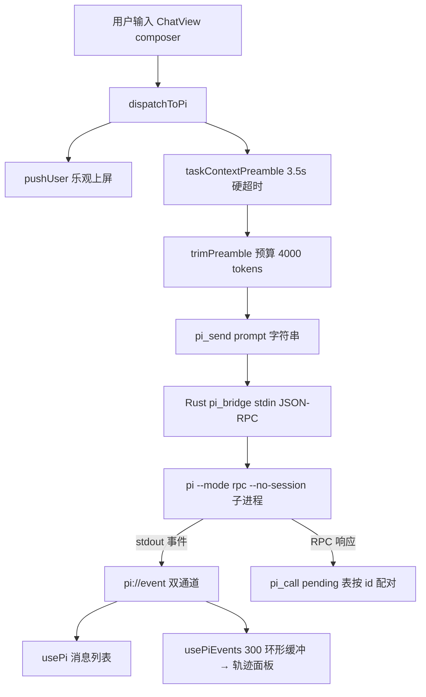
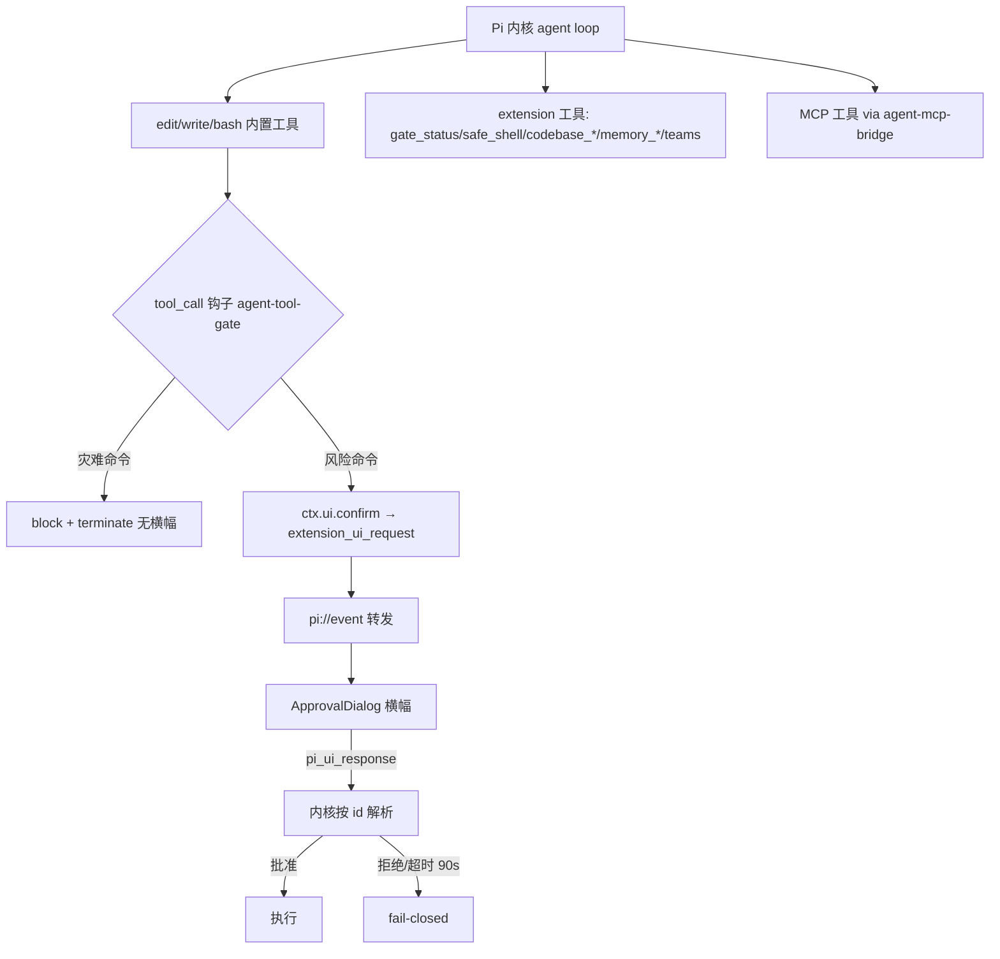

# 核心对话 / Work 执行链路全面差距报告（pi-workbench）

> 版本：2026-10-13 · 审计对象：pi-workbench HEAD（Tauri 2 + Vue 3 + Pi 0.87.1 `--mode rpc` 内核）
> 方法：全部结论以本仓库源码 `file:line` 为证据；业界做法附真实出处链接；DSH/WorkDSH 以 `docs/WORKDSH-ALIGN-26-harness-gap-analysis.md`、`docs/PI-VS-DSH-COMPARISON.md` 已核源码为参照。
> 结论先行：**当前版本在「对话能跑起来」上已成立，但在「work 执行」的四个业界标配机制上整体缺失——文件改动可见性、checkpoint/回滚、Plan 模式、优雅中断/会话持久化。内核 Pi 0.87.1 已提供其中大部分能力（`abort`/`steer`/`follow_up`/`new_session`/`switch_session`/`set_auto_compaction` 等 RPC），harness 层未接。**

---

## 0. 结论摘要（TL;DR）

| # | 结论 | 证据强度 |
|---|------|---------|
| 1 | **中断 = 杀内核进程**：`pi_stop` 直接 kill 子进程并清空 pending（不唤醒等待方），而 Pi RPC 原生有 `abort`（优雅中止当前轮）未接 | 源码实证 `pi_bridge.rs:615-621` vs 内核 `rpc-mode.js:329` |
| 2 | **会话不落盘**：`--no-session` 启动，消息只活在前端内存；journal 只存内核事件、**不含 user prompt 原文**，重开 App 即全丢 | `pi_bridge.rs:292`；ALIGN-26 A4 行自认 |
| 3 | **文件改动零可见**：消息流里 tool 事件只有一个名字 chip；没有 changed-files 列表、没有 diff、没有 per-file 接受/拒绝；artifacts 用正则从 assistant 文本嗅探路径兜底 | `piEvents.ts:139-141`、`MessageList.vue:75-78`、`artifacts.rs:171-198` |
| 4 | **无 checkpoint/回滚**：全仓 Rust 零 git 调用、零快照机制。业界三强（Claude Code / Cursor / Aider）全部把「每轮可回滚」当保命功能 | grep 实证；业界文档见 §2 |
| 5 | **无 Plan 模式**：头部 ModeSwitcher 只是 thinking level（low/medium/high）映射 | `ChatView.vue:662-676` |
| 6 | **审批无上下文**：横幅只有命令文本，无 diff 预览、无「始终允许」、无规则文件；策略靠手改 `governance.json` | `ApprovalDialog.vue`、ALIGN-26 P3 行 |
| 7 | **Pi 内核 17 个已暴露 RPC 能力未接**（steer/follow_up/队列/autocompact/switch_session/export_html/get_entries…） | 内核 `rpc-mode.js` case 清单 vs 本仓 `usePi.ts` 只用了 6 个 |
| 8 | **streaming 期间禁发**：无消息队列（内核原生 `follow_up` 队列未接） | `ChatView.vue:167` |

---

## 1. 现状：核心链路实际怎么跑的（事实）

### 1.1 对话执行链（发送 → 渲染）

- 乐观 UI + 前缀超时兜底已做（`ChatView.vue:548-583`），「点了没反应」类问题有防护。
- 内核自灭有 `process_exit` 系统消息提示（`usePi.ts:196-205`）。
- 限流/重试噪音已于 2026-10-12 收敛（同轮去重 + 重试行原地更新，`piEvents.ts`）。

### 1.2 工具执行链（work 真正发生的地方）

**已成立的**：三级闸门（block/confirm/allow）判定逻辑有 18 条单测；审批回传协议跨进程链路完整；MCP 桥从 Pi 侧发起（ALIGN-26 A6 已修）；`spawnSync` 阻塞已修（A1 已修）。

**未成立的**：执行结果回前端后**没有任何结构化呈现**——`piEvents.ts:139-141` 只把 `tool_use` 记成一条空文本 chip；轨迹面板的 `detailOf` 把参数/输出压成 100 字符 snippet（`piEventKind.ts:139-148`）。bash 输出、edit 结果（改了哪个文件、多少行）在对话区不可见、不可展开。

### 1.3 过程可见性

- ComposerStatus 常驻状态行（转圈/已索引/中断/用量）✅
- step-strip 同名工具聚合计数（`bash ×3 · 共 9 步 · 42.6s`）✅（`ChatView.vue` `stepGroups`，批 1 F6；此前为最近 4 个 chip 重复平铺）
- TraceDrawer 四 tab：会话树 / 轨迹 / 工作流 / 连接器 ✅
- journal 落盘 + 手动重放 ✅（`pi_bridge.rs:275-280`、`useReplay.ts`）
- 治理用量聚合（tokens/cost per model）✅

### 1.4 会话与上下文

| 能力 | 现状 | 证据 |
|------|------|------|
| 会话树 / fork | ✅ 已修（仅 user 消息可分叉） | `useSessionTree.ts` |
| 压缩 | ✅ 内核 `compact`，120s 超时 | `ChatView.vue:590-610` |
| 上下文预算 | ✅ CJK 感知估算 + 按行优先级裁剪 4000 tokens | `contextBudget.ts` |
| thinking level | ✅ 三档映射 | `ChatView.vue:662-676` |
| **会话持久化** | ❌ `--no-session`，内存态 | `pi_bridge.rs:292` |
| **autocompact** | ❌ `set_auto_compaction` 已暴露未接 | 内核 `rpc-mode.js:423` |
| **steer / follow_up 队列** | ❌ 未接 | 内核 `rpc-mode.js:321-328` |
| **switch_session / clone / export_html** | ❌ 未接 | 内核 `rpc-mode.js:476/490/472` |

### 1.5 项目 / 文件 / 终端

- ProjectWorkspace：文件树 / 终端 / 浏览器面板存在（`src/components/fs/`、`useTerminal.ts` + `terminal.rs` 的 `term_exec`）。
- FileEditorPane：读/改/写回，**仅在 path/root 变化时重读**——agent 在外部改了同一文件，编辑器不刷新（`FileEditorPane.vue` watch）。
- artifacts 自动成果面板：正则从 assistant 文本嗅探路径（`artifacts.rs:171-198`），是「没有 tool-call 级文件跟踪」的替代品，脆弱（模型不提路径就漏）。

---

## 2. 业界基准（真实出处）

### 2.1 Claude Code —— checkpointing / rewind（官方文档）

出处：https://docs.anthropic.com/en/docs/claude-code/checkpointing

- 每个开始新回合的 prompt **自动创建 checkpoint**（代码状态快照），会话内保留最近 100 个；
- `/rewind`（或空输入框按两次 Esc）列出本会话每个 prompt，可选动作：
  - **Restore code and conversation / Restore code / Restore conversation**（代码与对话可分别回滚）；
  - **Summarize from here**（把此点之后的对话压成摘要，释放上下文，不动磁盘文件）；
- checkpoint 随会话持久化（resume 后仍可 rewind），默认 30 天清理；
- 明确限制：bash 命令产生的文件变更**不跟踪**（只跟踪 file editing tools）——所以它是「会话级本地撤销」，与 git 互补而非替代。

### 2.2 Cursor —— Agent diff 评审 / Restore Checkpoint / 队列 / 模式

出处：https://cursor.com/help/ai-features/agent

- 编辑**在 diff 视图中实时显示**，用户检查并拒绝不需要的更改（per-hunk accept/reject）；
- 悬停历史消息 → **Restore Checkpoint**：回滚该消息之后 agent 的全部文件改动（只还原文件，不动对话）；
- **消息队列**：agent 忙时提交下一条指令自动排队、可拖拽排序；
- **四种模式**：Agent / Ask（只读）/ **Plan（先审方案再执行）** / Debug；
- 子智能体并行（独立上下文窗口）、危险命令审批门（可配置 per-command allowlist）。

### 2.3 Aider —— repo map / 编辑后自动校验回路 / git 原子提交

出处：https://github.com/Aider-AI/aider（Apache-2.0）；机制梳理见 pyshine.com/aider 源码走读

- **repo map**：tree-sitter 抽全仓符号定义 + 引用图 PageRank 排序，默认 1000 token 预算随每轮请求自动携带——不把整个仓库塞进上下文也让模型知道符号在哪；
- **编辑格式抽象**：SEARCH/REPLACE 块等 5-14 种 coder 变体，SEARCH 侧必须匹配当前文件内容，**模糊/过期编辑大声失败**而不是静默写坏；
- **git 一等公民**：每次编辑自动原子提交（弱模型写 commit message），`/undo` 直接回退上一次 AI 修改，`/diff` 看工作区差异；
- **编辑后固定回路**：auto-commit → auto-lint → auto-test，失败输出作为 reflected_message 回灌模型，`max_reflections = 3` 封顶；
- **architect/editor 双模型**：强模型提案、便宜模型产 diff。

### 2.4 WorkDSH / DSH（本仓已核源码的参照）

出处：`docs/WORKDSH-ALIGN-26-harness-gap-analysis.md`（techflag/workdsh desktop-v2.0.6-alpha.5 源码核实）

- harness 闸门 = **confirmation + execution-guard**：工具执行前确认 + 执行守卫；
- **plans 运行态**：专家编译成 preset，计划可运行可跟踪；
- 会话持久化 = 本地 **SQLite** + 恢复；
- Cordis 插件体系（npm 包、市场安装/启禁/版本）、治理五件套（identity/access/audit/model-policy/usage）；
- 受控 shell（超时/截断/危险命令拦截）。

---

## 3. 逐项差距总表

状态：✅ 已实现且接真实链路 ｜ 🟡 有雏形/部分 ｜ ❌ 缺失 ｜ 💀 当前实现是坏的/假的

| # | 维度 | 业界基准（出处 §2） | pi-workbench 现状（证据） | 判定 |
|---|------|--------------------|--------------------------|------|
| 1 | 中断当前轮 | Cursor Stop 停 agent 不杀进程；内核有 `abort` RPC | `pi_stop` kill 整个子进程 + `pending.clear()` 不唤醒等待方（`pi_bridge.rs:615-621`） | 💀 |
| 2 | 会话持久化 | Claude Code resume + checkpoint 持久化；DSH SQLite | `--no-session`，消息仅前端内存；journal 不含 prompt 原文（`pi_bridge.rs:292`） | ❌ |
| 3 | 文件改动可见性 | Cursor 实时 diff 视图 | tool 事件只记名字 chip（`piEvents.ts:139-141`） | ❌ |
| 4 | changed-files 列表 / per-file 接受拒绝 | Cursor per-hunk；Claude Code 跟踪 edit 工具 | 无；artifacts 正则嗅探文本兜底（`artifacts.rs:171-198`） | 🟡（兜底脆弱） |
| 5 | checkpoint / rewind | Claude Code /rewind；Cursor Restore Checkpoint；Aider /undo | 全仓零 git、零快照（grep 实证） | ❌ |
| 6 | Plan 模式 | Cursor Plan mode；DSH plans 运行态 | ModeSwitcher = thinking level 三档（`ChatView.vue:662-676`） | ❌ |
| 7 | 消息队列 | Cursor 排队+拖拽；内核 `follow_up` | streaming 时禁发（`ChatView.vue:167`） | ❌ |
| 8 | mid-turn 引导注入 | Cursor 队列语义；内核 `steer` | 未接 | ❌ |
| 9 | 审批上下文 | Claude Code diff + allowlist 规则；DSH confirmation | 横幅仅命令文本；无 diff、无「始终允许」、无规则 UI（`ApprovalDialog.vue`） | 🟡 |
| 10 | 审批策略管理 | Claude Code permission rules 文件；DSH 治理五件套 | `governance_get/set` 命令在，UI 缺（手改 JSON） | 🟡 |
| 11 | 工具结果结构化 | Claude Code 内联 diff/终端输出；Cursor 终端输出 | 100 字符 snippet（`piEventKind.ts:139-148`） | 🟡 |
| 12 | 编辑后 lint/test 回路 | Aider auto-lint/auto-test + 回灌 max 3 轮 | 无 harness 级 post-edit hook（靠 agent 自觉跑 bash） | ❌ |
| 13 | repo map 自动注入 | Aider map-tokens 1000/轮 | agent-codebase 索引存在但仅 on-demand 工具；preamble 无结构地图（`contextBudget.ts`） | 🟡 |
| 14 | @-mention 上下文 | Cursor @file/@folder/@docs/@web/@diff/@terminal | 无 mention 系统，仅附件路径引用块 | ❌ |
| 15 | autocompact | Claude Code 自动压缩 | `set_auto_compaction` 已暴露未接（内核 `rpc-mode.js:423`） | ❌ |
| 16 | 外部编辑冲突 | Cursor/Claude Code 文件 watcher 同步 | FileEditorPane 仅 path/root 变化重读 | ❌ |
| 17 | bash 沙箱 | Cursor/Claude Code sandbox；DSH 受控 shell | agent-guard 黑名单 + 宿主 PATH 白名单，非隔离 | 🟡 |
| 18 | 多会话并行 | Cursor 多 chat；DSH 每会话 runtime | 全局单 PiState 单签名（ALIGN-26 B7） | 🟡 |
| 19 | 审批「始终允许」记忆 | Cursor per-command allowlist | 无 | ❌ |
| 20 | 内核已暴露未接 RPC | — | 17 个（见 §5 附录） | ❌ |
| 21 | 消息流增量渲染/大输出 | Claude Code 可展开输出 | 截断 snippet | 🟡 |
| 22 | 崩溃恢复 | Claude Code resume；DSH SQLite | journal 手动重放一次性（`useReplay.ts`），无自动恢复、无 prompt 原文 | 🟡 |

---

## 4. 详细缺口清单（按优先级，全部列出）

### P0 —— 保命级（直接决定「敢不敢让 agent 干活」）

#### G1. 中断应走内核 `abort`，而不是杀进程
- **现状**：`abort()` → `interrupt()` + `pi_stop()`；`pi_stop` 做两件事：`pending.clear()`（直接丢弃，**不唤醒等待方** → 进行中的 `pi_call`（如 compact）干等 30s 超时）、`stop_child` kill 进程（`pi_bridge.rs:615-621`）。下一条消息靠 `dispatchToPi` 捕获「pi 未启动」自动重启兜底（`ChatView.vue:564-576`）。
- **业界**：Cursor Stop 只停当前 agent 任务，进程与上下文保留；内核 Pi 0.87.1 原生提供 `abort` RPC（`rpc-mode.js:329`，`session.abort()`）。
- **补法**：`usePi.abort()` 改调 `rpc('abort')`；保留 `pi_stop` 仅用于「停止内核」显式动作；`pi_stop` 内 `pending` 改为 drain + 回送失败响应（与 `drain_pending_on_restart` 同款，`pi_bridge.rs:788` 已有先例）。
- **验收**：中断后会话树/上下文保留；进行中 compact 的 `pi_call` 立即收到失败响应而非 30s 挂起；真机回归（ALIGN-26 §7.1 同款步骤）。

#### G2. 文件改动可见性：changed-files + diff
- **现状**：`message_update` 的 `tool_*` 事件只 push 一条空文本 chip（`piEvents.ts:139-141`）；MessageList 渲染成图标+工具名（`MessageList.vue:75-78`）；用户看不到 agent 改了哪个文件、改了什么。
- **业界**：Cursor 在 diff 视图实时显示每次编辑、per-hunk 接受/拒绝；Claude Code 只跟踪 file editing tools 但全部记录进 checkpoint。
- **补法**（harness 侧，不动内核）：`tool_call` 事件若 `toolName ∈ {edit, write}`，提取 `path/old/new` 落进 `PiMsg.fileChanges[]`；消息流该条消息下渲染「📝 N 个文件」列表，点击展开 diff（前端 diff 库或自绘 unified diff）；轨迹面板同步。artifacts 正则嗅探降级为兜底。
- **验收**：让 agent 改 3 个文件 → 对话区出现 3 个 changed-file 行 + 可展开 diff；单测覆盖 `edit/write` 参数解析。

#### G3. checkpoint / rewind（本地撤销）
- **现状**：无。全仓 Rust 无 git 调用（grep 实证），无文件快照。
- **业界**：Claude Code 每 prompt 前快照 + `/rewind`（恢复代码/对话/两者/摘要，四种动作）；Cursor 每消息 Restore Checkpoint；Aider 每编辑自动 commit + `/undo`。
- **补法**（两档，先 A 后 B）：
  - A（纯 harness，当天可做）：`prompt` 下发前，把本轮 `edit/write` 目标文件复制到 `<config>/.pi/snapshots/<turn>/`（只快照工具声明过的文件，不做全仓）；消息气泡加「回到此处」→ 还原快照 + fork 会话树到该 prompt 前节点（内核 `fork` 已通）。
  - B（git 项目增强）：项目是 git repo 时，每轮自动 `git stash create` 式快照或轻量 commit（`git add -A && git commit` 到独立 branch `pi-checkpoints`），rewind 走 `git checkout`。
- **边界**（对齐 Claude Code 文档明示的限制）：bash 产生的文件变更不在快照范围，需在 UI 标注。
- **验收**：agent 连续改 7 个文件第 3 步走偏 → 回到第 2 步 prompt 前，文件与对话均还原。

#### G4. 会话持久化（崩溃/重启可恢复）
- **现状**：`--no-session`（`pi_bridge.rs:292`）；journal 只写内核事件，**user prompt 原文不在重建范围**（ALIGN-26 A4 行自认）；App 重开 = 对话全丢。
- **业界**：Claude Code 会话恢复；DSH SQLite 会话存储；Cursor 聊天持久化。
- **补法**（两档）：
  - A（不动内核）：`pi_send` 时把 `{prompt, attachments, ts}` 一并 append 进 journal（改 journal 写入处加一行 user_prompt 记录）；`useReplay` 重建时按 user_prompt 还原轮次；App 启动自动重放最近 journal。
  - B（内核能力）：去掉 `--no-session`（或 `new_session` 显式管理），接 `switch_session` / `get_messages` / `export_html`（内核 `rpc-mode.js:476/536/472`），会话列表走 `get_entries` durable cursor。
- **验收**：发 3 轮 → 杀 App → 重开 → 对话区恢复 3 轮原文；进行中的 turn 状态不假死。

### P1 —— 核心体验（业界标配，直接体感差距）

#### G5. Plan 模式（先审方案再动手）
- **现状**：ModeSwitcher 三档 = thinking level（`ChatView.vue:662-676`），与「计划评审」无关。
- **业界**：Cursor Plan mode（多文件特性先 review approach）；DSH plans 运行态；Claude Code 计划批准流。
- **补法**：新 prompt 前缀注入 plan 指令（`[模式] 先输出分步计划，等用户确认后执行`）；agent 输出计划 → 消息流渲染计划卡（步骤 checklist + 「开始执行/修改计划」按钮）→ 确认后才发执行 prompt。复用现有 `dispatchToPi` + 消息流，纯前端 + prompt 层可落地。
- **验收**：Plan 模式下发任务 → 先出计划卡 → 点执行才动工具。

#### G6. 消息队列 + mid-turn steer
- **现状**：streaming 时 send 禁用（`ChatView.vue:167`）。
- **业界**：Cursor 排队+拖拽；内核有 `follow_up`（入队）与 `steer`（注入当前轮）（`rpc-mode.js:321-328`）。
- **补法**：streaming 中提交 → `follow_up` 入队，composer 上方显示队列 chip（可撤销）；「插话」按钮 → `steer`。
- **验收**：agent 执行中发第二条 → 队列显示 → 本轮结束自动执行。

#### G7. 审批上下文增强（diff 预览 + 始终允许 + 规则）
- **现状**：横幅只有命令文本（`ApprovalDialog.vue`）；无「始终允许此类命令」；策略手改 `governance.json`。
- **业界**：Claude Code permission rules（allowlist 文件）；Cursor per-command 审批 + allowlist；DSH confirmation/execution-guard。
- **补法**：① 审批横幅对 edit/write 展示 diff（复用 G2 的 diff 渲染）；② 「始终允许 `bash:git *` 模式」写入 `governance.json`（`governance_set` 已有），agent-tool-gate 启动时读规则表；③ 设置页接 `governance_get/set` 做规则编辑 UI。
- **验收**：批准一次 `npm test` 后选「始终允许」→ 后续同模式命令直接放行；规则落 `governance.json` 重启仍生效。

#### G8. 工具结果结构化渲染
- **现状**：`detailOf` 100 字符 snippet（`piEventKind.ts:139-148`）；bash 长输出不可见。
- **补法**：轨迹面板 tool_result 行可展开全文（等宽、可复制）；对话区 tool chip 点击展开「参数 / 输出」折叠块（`
` 式，与 index.vue humanizeError 同款交互）。
- **验收**：跑 `pnpm vitest run` → 输出可展开、可复制、不截断关键行。

#### G9. 编辑后自动 lint/test 回路（Aider 模式）
- **现状**：无 harness 级 post-edit hook。
- **补法**：Rust 侧监听 `edit/write` tool_result 成功 → 按项目配置（`governance.json` 或项目 config）跑 lint/test 命令 → 失败摘要作为系统消息回灌消息流（**不回灌模型**，保持人审；可选开关「自动回灌」走 `follow_up`）。
- **验收**：agent 改完 TS 文件 → 自动跑 `vue-tsc --noEmit` → 错误落消息流。

#### G10. repo map 注入 preamble
- **现状**：codebase 索引已建（3130 节点实测）但仅 on-demand 工具；`taskContextPreamble` 只有项目/指令/能力/引用。
- **业界**：Aider repo map 每轮自动携带（1000 token 预算）。
- **补法**：`taskContextPreamble` 增加 `[代码地图]` 段：从 codebase-memory-mcp `get_architecture` 或 graphify 取 top-N 符号摘要，纳入 `trimPreamble` 预算体系统一裁剪。
- **验收**：preamble 含地图段且超预算时按优先级裁剪（现有 `contextBudget.spec.ts` 扩展用例）。

#### G11. autocompact + auto_retry 策略接通
- **现状**：`set_auto_compaction`/`set_auto_retry`/`abort_retry` 内核已暴露（`rpc-mode.js:423-434`），未接。
- **补法**：启动内核后按 `governance.json` 策略 `rpc('set_auto_compaction', {...})`；用户点「中断重试」→ `abort_retry`。
- **验收**：长会话自动压缩触发有系统消息；重试中可手动中止。

### P2 —— 体验打磨 / 域能力

| # | 缺口 | 现状证据 | 补法 |
|---|------|---------|------|
| G12 | @-mention 上下文注入 | composer 无 mention 系统 | 输入框 `@` 触发文件/符号/历史会话/终端输出选择，插入引用块进 prompt |
| G13 | 外部编辑冲突 | `FileEditorPane.vue` 仅 path/root 重读 | fs watcher（`notify` crate）→ 文件外部变化时编辑器提示「已外部修改，重新加载」 |
| G14 | bash 沙箱 | agent-guard 黑名单非隔离 | 最小可行：`safe_shell` 工具默认启用 + 项目级 PATH 白名单；真隔离评估 Pi 原生沙箱演进 |
| G15 | 多会话并行 | 全局单 PiState 单签名 | 短期子内核抽象（受控 spawn、带 cwd/model、超时回收）——ALIGN-26 B7 已有设计 |
| G16 | 崩溃自动恢复 | journal 手动重放 | G4-A 落地后启动自动重放 + 「恢复上次会话」提示条 |
| G17 | export_html / get_entries | 未接 | 会话导出 HTML（内核原生）；`get_entries` durable cursor 做增量同步 |
| G18 | 审批真机回归 | ALIGN-26 §7.1 待做 | 按 §7.1 步骤真机跑一轮（批准/拒绝/超时/disaster block） |
| G19 | 压缩真机回归 | ALIGN-26 §7.2 待做 | 20+ 轮对话后点压缩，验 UI 流畅与摘要质量 |
| G20 | memory 语义召回 | 词面 bigram 评分（ALIGN-26 B5） | 按 ALIGN-26 §7.3 方案 A：Ollama/bge-m3 向量 + RRF 融合 |
| G21 | browser DOM 注入 | agent-browser-session 仅开浏览器 | 参考 browser-use/Playwright MCP 序列化 DOM 喂 agent |
| G22 | 插件市场服务端 | PluginsView 本地扫描 | 社区服务端（可后置） |
| G23 | 自更新 | Tauri 打包但无 updater | tauri-plugin-updater（可后置） |
| G24 | 策略编辑 UI | `governance_get/set` 有命令无 UI | 设置页接命令（G7③ 附带） |

---

## 5. 附录：Pi 0.87.1 已暴露但 harness 未接的 RPC 清单

来源：内核 `dist/modes/rpc/rpc-mode.js` case 清单（`/opt/homebrew/lib/node_modules/@earendil-works/pi-coding-agent`）。

| RPC | 语义 | 本仓状态 | 对应缺口 |
|-----|------|---------|---------|
| `abort` | 优雅中止当前轮 | ❌ 未接（用 pi_stop 杀进程） | G1 |
| `steer` | 向当前轮注入引导消息 | ❌ | G6 |
| `follow_up` / `clear_queue` | 消息入队 / 清队 | ❌ | G6 |
| `new_session` | 新建会话（可带 parentSession） | ❌ | G4 |
| `switch_session` | 切换会话文件 | ❌ | G4/G17 |
| `clone` | 从当前叶克隆会话 | ❌（fork 已接） | G3 |
| `get_messages` | 取会话消息 | ❌ | G4 |
| `get_entries {since}` | durable cursor 增量条目 | ❌ | G17 |
| `export_html` | 导出会话 HTML | ❌ | G17 |
| `set_session_name` | 会话命名 | ❌ | G17 |
| `set_auto_compaction` | 自动压缩策略 | ❌ | G11 |
| `set_auto_retry` / `abort_retry` | 自动重试策略 / 中止重试 | ❌ | G11 |
| `set_steering_mode` / `set_follow_up_mode` | steer/follow_up 行为模式 | ❌ | G6 |
| `abort_bash` | 中止执行中的 bash | ❌ | G1 |
| `get_fork_messages` | 取可分叉的用户消息列表 | ❌（forkTargetId 自算） | G3 |
| `bash`（内核代执行） | 内核侧执行 bash | ❌（agent 自行 bash） | — |
| `get_commands` | 命令清单 | ❌ | — |

已接：`prompt`（pi_send）、`get_tree`、`fork`、`compact`、`set_thinking_level`、`pi_call` 通用通道。

---

## 6. 修复路线图（排序：坏 > 缺 > 体验 > 域）

| 阶段 | 项 | 预期产出 | 闸门 |
|------|----|---------|------|
| **P0-a** | G1 中断改 abort + pi_stop drain | 中断不杀上下文、不挂 RPC | cargo test + 真机中断回归 |
| **P0-b** | G2 changed-files + diff | 对话区可见每次编辑 | vitest（参数解析）+ UI 回归 |
| **P0-c** | G3 checkpoint/rewind（A 档快照） | 每轮可回滚文件+对话 | 快照/还原纯函数单测 + 真机 7 文件场景 |
| **P0-d** | G4 会话持久化（A 档 journal 带 prompt） | 重开 App 恢复对话 | 重启恢复真机回归 |
| **P1-a** | G5 Plan 模式 | 计划卡 + 确认后执行 | chatStage/plan 纯函数单测 |
| **P1-b** | G6 队列 + steer | 执行中可发下一条 | 队列状态机单测 |
| **P1-c** | G7 审批 diff + 始终允许 + 规则 UI | 审批可决策、可记忆 | 规则匹配纯函数单测 + 真机 |
| **P1-d** | G8 结果展开 / G9 lint-test 回路 / G10 repo map / G11 autocompact | 过程完整可见、质量自检 | 各自单测 + build 全过 |
| **P2** | G12–G24 | 体验与域能力补齐 | 逐项验收 |

**已有优势（保持并放大）**：全双工 RPC + 30s 超时门 + 主线程冻结源码级回归测试；journal + 手动重放；tool gate 三级判定 fail-closed；contextBudget 上下文预算；MCP 桥（Pi 侧发起）；agent-teams 异步调度 + 真策略；治理用量聚合；代码库索引（实测 3130 节点/8836 边）；ComposerStatus 常驻可见性；会话导入/导出。

---

## 7. 验证现状（本报告审计时点的门禁状态）

> 数字为**审计时点快照**，会随后续修复变化；**当前一律以闸门实跑输出为准**。复现命令：
> `pnpm typecheck` · `pnpm build` · `pnpm test` · `node scripts/visual-check.mjs` · `cd src-tauri && cargo check && cargo test`

- `cargo check` ✅ · `cargo test`（含 journal/policy 单测）✅
- `pnpm typecheck`（vue-tsc --noEmit）exit 0 ✅ · `pnpm build`（vite build）✅
- `pnpm test`（vitest）全绿 ✅（审计时点为 185/185，2026-10-12 修复后；**最新通过数以闸门输出为准**）
- `node scripts/visual-check.mjs`（verify:ui）全绿 ✅（审计时点 57/57 PASS；**最新以闸门输出为准**）
- graphify 同步 ✅
- **未覆盖（本报告 P0/P1 的直接依据）**：真机中断回归、真机压缩回归、真机审批链路回归——全部登记在 ALIGN-26 §7.1/§7.2，均未执行。

## 8. 参考链接

- Claude Code Checkpointing：https://docs.anthropic.com/en/docs/claude-code/checkpointing
- Cursor Agent 模式：https://cursor.com/help/ai-features/agent
- Aider（仓库与文档）：https://github.com/Aider-AI/aider
- Aider 源码走读（repo map / edit formats / 回路）：http://pyshine.com/aider
- WorkDSH：https://github.com/techflag/workdsh（本仓 ALIGN-26 已核源码）
- Pi 内核 RPC 清单：本机 `/opt/homebrew/lib/node_modules/@earendil-works/pi-coding-agent/dist/modes/rpc/rpc-mode.js`
